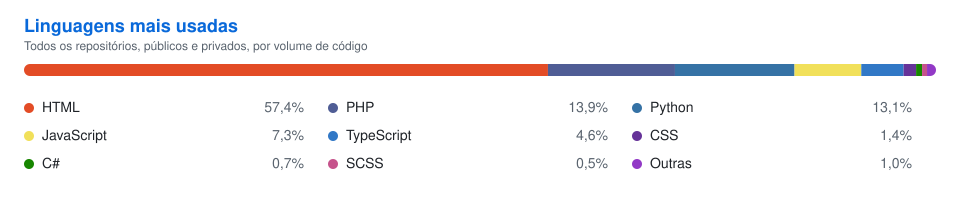

# Gustavo Ribeiro Pulz

**Desenvolvedor Web · Front-end & Back-end**

Web Designer na [BluePex Cybersecurity](https://www.bluepex.com) · Limeira, SP — Brasil

---

## Sobre

Desenvolvo sites e sistemas web do layout à implementação, com foco em clareza, performance e manutenção. Atuo no front-end com React, Next.js e TypeScript, e no back-end com Node.js, NestJS, Python, Go e PHP.

## Stack

| Área | Tecnologias |
| --- | --- |
| **Front-end** |      |
| **Back-end** |      |
| **Bancos de dados** |     |
| **DevOps & Ferramentas** |     |

## Projetos

| Projeto | Descrição |
| --- | --- |
| [**Finance System**](https://finance-system.prxlab.com.br/login) | Sistema financeiro para centralizar contas, pagamentos e compartilhamentos. |
| [**ACID/C**](https://acidc.com.br) | Site da banda tributo ao AC/DC: agenda de shows, galeria e contato. |
| [**PRXLab**](https://prxlab.com.br) | Site institucional da PRXLab, empresa de desenvolvimento de software. |
| [**BRG Mancais**](https://www.brgmancais.com.br) | Site institucional da BRG Mancais: engenharia, fundição e usinagem de mancais. |
| [**Villa Alemã**](https://villaalema.com.br) | Site institucional da cervejaria Villa Alemã. |

## Estatísticas

---

Aberto a conversas sobre projetos e oportunidades. [Fale comigo](mailto:pulzgustavo1@gmail.com).

